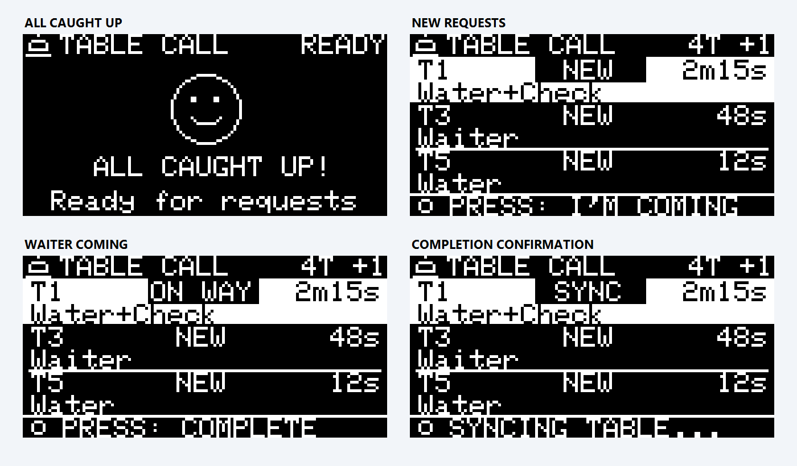

# TableCall: ESP32 restaurant service request system

A makeathon prototype that lets restaurant guests request a waiter, water, or
the check using three physical buttons. Table units communicate over ESP-NOW
with a waiter-worn OLED receiver that groups requests by table and shows waiting
times. One waiter button marks the front table's requests as coming, then fulfilled;
the corresponding table LEDs move from solid to flashing to off.

This repository includes the firmware, hardware notes, native regression tests,
wiring diagrams, and OLED display previews for the prototype.



**Prototype status:** this is a makeathon demonstration, not a production-ready
restaurant installation. Battery-powered watch reception has an unresolved issue
that can require a watch reset. Automatic sender replay improves recovery, but
does not establish the root cause. The no-transistor buzzer diagram is conditional
on verifying the exact buzzer's current at 3.3 V; use the documented transistor
driver if GPIO compatibility has not been established. Use a supported regulated
power input; a 9 V battery must not be connected directly to the board's 5 V pin.

Two ESP32 Dev Modules communicate directly using ESP-NOW. No router, password,
internet connection, or MAC-address editing is needed. Use one receiver for this demo.

## Firmware

- `src/sender.cpp`: three debounced buttons, table ID, independent request
  lifecycles, receiver acknowledgments, automatic delivery retries, and three request LEDs.
- `src/receiver.cpp`: SSD1306 128x64 monochrome I2C OLED, a 20-request queue,
  grouped by table, three visible table groups with timers, a 150 ms buzzer
  notification, and one two-stage waiter confirmation button.
- `include/request_system.h`: common packet format, buttons, and radio code.
- `include/request_protocol.h`: protocol version 2 and monotonic request states.
- `include/watch_queue.h`: grouped FIFO queue and elapsed-time formatting.
- `include/delivery_retry.h`: five fast attempts, then periodic replay of open requests.
- `include/watch_display.h`: monochrome display layout shared with the preview renderer.

Display preview: [four UI states at 5x pixel scale](docs/watch-display-preview.png).
The SSD1306 is monochrome; software cannot add RGB colors. The UI uses an inverted
front-table card, a service-bell mark, compact status badges, right-aligned timers,
and a static smiley on the idle screen. No battery level or signal strength is
invented, and there is no animated background or extra refresh loop.

The screen shows the first THREE table groups. Each group uses two lines: table
number, state, and elapsed time on the first, then its combined requests below.
The white highlighted card marks the front table; the button always acts on it.
Tables are ordered by when their first open request arrived. Completing a whole
table group moves the remaining list up and brings later tables into view.
The header shows the table-group count, with `+N` for groups beyond the visible three.
There is no selection menu or automatic page rotation.

```text
TABLE CALL      4T +1
T1   NEW       2m15s
Water+Check
T3   NEW         48s
Waiter
T5   NEW         12s
Water
o PRESS: I'M COMING
```

Request names are written in full: `Waiter+Water+Check`. Badges: `NEW` waiting,
`ON WAY` waiter coming, `SYNC` fulfilled and waiting for LED confirmation.
The action strip reads `PRESS: I'M COMING`, then `PRESS: COMPLETE`, then
`SYNCING TABLE...`. Idle shows `ALL CAUGHT UP!` and `Ready for requests`.
The 128-pixel width fits all three names on one line. Timers refresh once per
second and show the time since the watch received that group's oldest request;
they are not a synchronized timestamp from the table. New requests added to the
same visit do not reset its timer. Longer waits use minutes, hours, then days.

| Event | Corresponding table LED | Waiter display/action |
| --- | --- | --- |
| Customer presses request button | Solid immediately | Request arrives and buzzer beeps |
| Waiter presses once | All LEDs for the front table's requested items flash | Coming; next press fulfills group |
| Waiter presses again | All LEDs for that group's requested items turn off | Advances after every item is confirmed |

The three table buttons still have independent LEDs. Repeated presses while a
request is active do not create duplicates. On the watch, all open requests for
one table are handled together. An additional request received while its waiter
is coming joins that group and inherits Coming. A request received AFTER the
completion press starts a fresh visit at the back of the queue, even if LED-off
confirmations for the old visit are still arriving. Holding the watch button
causes only one action; release and press again for the next stage. Receipt by
the receiver does not start flashing: the waiter's first button press does that.

Both boards need protocol version 2; version 1 and version 2 do not communicate.
If the table already has the three-LED/two-stage sender firmware, only the WATCH
needs re-uploading for this grouped display update. No wiring changes are needed.

## Sender wiring

Complete schematic for both units: [PNG image](docs/wiring-schematic.png) or
[scalable SVG](docs/wiring-schematic.svg). The diagram uses GPIO labels, not
physical header positions. The current drawing is the requested no-transistor
variant; direct buzzer drive remains conditional on verifying current at 3.3 V.
The previous [transistor schematic](docs/wiring-schematic-transistor.png) is also saved.

| Part | ESP32 connection |
| --- | --- |
| Waiter button | GPIO 26 to button to GND |
| Water button | GPIO 27 to button to GND |
| Check button | GPIO 25 to button to GND |
| Waiter request LED | GPIO 21 to 330 ohm resistor to LED anode; cathode to GND |
| Water request LED | GPIO 18 to 330 ohm resistor to LED anode; cathode to GND |
| Check request LED | GPIO 19 to 330 ohm resistor to LED anode; cathode to GND |

The original working sender channels are preserved: button pins `{25,26,27}`
pair with LED pins `{19,21,18}`. Their legacy packet enum names do not match the
physical labels. Only `watchRequestLabel()` translates them for the OLED:
wire Waiter -> displayed Check; wire Water -> displayed Waiter; wire Check ->
displayed Water. ACKs still use original IDs so the correct physical LED updates.

Buttons use internal pull-ups; do not connect them to 5 V. With a four-leg tactile
switch, choose two contacts that are disconnected when released and connected
when pressed. The two legs on a given side may already be connected internally.

Each external LED must have its own resistor. The longer lead is usually the anode
and the flat side usually marks the cathode. This wiring assumes ordinary individual
LEDs; LED modules or illuminated buttons can require different connections.
GPIO 2's onboard LED is no longer used. Sender GPIO 18 is available because the
OLED I2C wires are connected to the separate receiver board.

A solid LED means the customer made an unresolved request; it does not guarantee
radio delivery. The sender makes five quick attempts, then retries about every
five seconds for as long as the request stays open. Even confirmed open requests
are replayed periodically so a restarted watch can rebuild its queue. Duplicate
IDs are recognized by the watch; routine replay does not add entries or beep again.
Pressing an active button forces an immediate replay of the SAME request, without
changing its LED state or creating another request. All button and LED pins remain
as documented above. Only fulfillment stops replay for that request.

## Receiver wiring

The actual module is marked **GME12864-11-12-13 V3.22**: a 0.96-inch, 128x64
monochrome SSD1306 I2C OLED. Manufacturer family reference:
https://goldenmorninglcd.com/oled-display-module/0.96-inch-128x64-ssd1306-gme12864-11/

This replaces the earlier SSD1331 SPI assumption. Follow the printed labels on
the four-pin header rather than assuming a physical pin order. Use 3.3 V power.

| OLED label | ESP32 connection |
| --- | --- |
| VCC | 3.3 V |
| GND | GND |
| SCL | GPIO 14 |
| SDA | GPIO 13 |

The watch uses SDA=13 and SCL=14. This replaces the previous GPIO12/13 mapping
and avoids using GPIO12 for the OLED. Rewire with power off, then re-upload
the receiver firmware.

The receiver probes addresses `0x3C` and `0x3D` automatically. If neither responds,
Serial Monitor reports the wiring to check, and initialization stops until reset.
No CS, DC, MOSI, or reset wire is used. The previous SPI OLED wiring is obsolete;
rewire the OLED and re-upload **receiver**. The version-2 sender is unchanged.

Waiter button: GPIO 27 to button to GND (same wiring as the old clear button).
First press marks the FRONT TABLE GROUP COMING; second press marks it FULFILLED.
State changes are retransmitted until acknowledged by the table. If the table is
unreachable at completion, the footer says "SYNCING TABLE..." and that front table
waits for ALL its LED-off confirmations. Upcoming tables remain visible below.
Restore the radio link to finish; no extra waiter press is needed. Further
presses during completion syncing are ignored.

### SFM-27 active buzzer

The requested no-transistor schematic shows:

- GPIO 25 directly to the buzzer red/positive lead.
- Buzzer black/negative lead to receiver GND.
- No 1 kohm resistor, 10 kohm resistor, or separate buzzer supply.

**Conditional connection, not hardware-verified:** the exact Stemedu SFM-27's
steady and startup current at 3.3 V have not been established. Verify those against
the board/chip GPIO drive specification before connecting it directly. An advertised
3-24 V operating range does not establish GPIO-current compatibility. Do not connect
5 V or the battery's positive terminal to GPIO 25. The existing firmware's HIGH pulse
is also the correct control polarity for a compatible direct-drive active buzzer.

If direct-drive compatibility cannot be established, leave the buzzer disconnected
or use the previous transistor circuit below. No code change is required for either.

Previous transistor option (saved separately in the schematic link above):

- Buzzer red/positive lead to regulated 5 V.
- Buzzer black/negative lead to transistor collector.
- Transistor emitter to GND.
- GPIO 25 through a 1 kohm resistor to transistor base.
- Optional 10 kohm resistor from base to emitter keeps the buzzer off during boot.
- Join the 5 V supply ground and ESP32 ground.

Check the transistor's actual pinout. Do not connect the 5 V buzzer supply to an
ESP32 GPIO. A USB-powered board's labeled 5 V/VIN pin can be used only if its board
documentation confirms that pin supplies USB 5 V; otherwise use a separate regulated
5 V supply with common ground. Do not feed an external supply into the board while
USB is connected unless the board supports that arrangement. Each board can be
powered separately by USB for the first demo; no wire connects the two ESP32s.

## Build and upload in VS Code

1. Open this project folder in PlatformIO.
2. Connect the receiver ESP32 by USB. Under **PlatformIO > Project Tasks > receiver**,
   choose **Build**, then **Upload**. Choose **Monitor** to view logs at 115200 baud.
3. Connect the table ESP32. Under **Project Tasks > sender**, choose **Build**,
   then **Upload**. The default build environment is sender, so explicitly select
   the receiver task when uploading the waiter device.
4. If both boards are connected, select the correct upload port for each task,
   or unplug the other board while uploading. Close Serial Monitor before uploading.
5. Press a table button. Expect one receiver beep and the matching table/request
   on the OLED, with its table LED solid. Press the waiter button once to make that
   group's LEDs flash; press it again to turn them off and advance to the next table.

PlatformIO installs the display libraries from `platformio.ini` automatically.
For an additional table device, change `-DTABLE_ID=1` in `platformio.ini` to
`-DTABLE_ID=2`, rebuild the **sender**, and upload it to the new table board.
Give every table its own ID. Existing boards keep their previously uploaded ID.

Equivalent commands in a PlatformIO terminal:

```powershell
pio run -e sender -e receiver
pio run -e receiver -t upload --upload-port COM5
pio run -e sender -t upload --upload-port COM6
pio device monitor --port COM6 --baud 115200
```

Replace COM5/COM6 with the actual ports. Do not upload both environments to the
same board; the last upload replaces its firmware.

## Demo checks

1. Press each table button: verify the corresponding LED is solid, a short beep,
   and the table's grouped `Waiter+Water+Check` line. It should occupy just one table group.
2. Hold a table button or press it repeatedly while active: verify no duplicate
   entries or beeps. Verify the other two LEDs retain their independent states.
3. Queue requests from multiple tables. Verify three table groups and three timers
   are visible; a fourth is counted as `+1`. First waiter press must flash ALL active
   request LEDs for the FRONT table and change `NEW` to `ON WAY`. Release and press again:
   all that group's LEDs turn off, the list moves up, and the fourth table appears.
   Holding the waiter button must not complete both stages.
4. After completion, press the same table button: verify a fresh request starts
   with a solid LED at the back of the table queue. Finish it through both presses.
5. Power off the receiver and press a table button: its LED stays solid, and the
   sender logs continuing retries. Wait at least 30 seconds, power the receiver
   on, and verify the request arrives automatically within about six seconds.
   Leave the request queued for a minute: periodic replay must not add duplicates
   or repeat the beep. Then reset only the watch while leaving the table powered:
   verify its queue repopulates automatically. Its timer/Coming progress can reset.
6. With both boards still powered, interrupt the radio link or move the table out
   of range after a request arrives. Make the waiter presses: verify the receiver
   says syncing. Restore range: verify the final LED state arrives automatically
   and the group advances only after every item is confirmed. Do not reset the
   table for this test; RAM is volatile.
7. With a second table ID, verify both table numbers appear correctly.
8. Fill the queue with distinct table/type pairs: verify additional requests are
   refused rather than silently replacing old ones; clear space and press again.

Hardware-free regression checks (using g++ in PowerShell):

```powershell
g++ -std=c++11 -Wall -Wextra -Werror -I include test/lifecycle_test.cpp -o .pio/lifecycle_test.exe
.\.pio\lifecycle_test.exe
g++ -std=c++11 -Wall -Wextra -Werror -I include test/watch_queue_test.cpp -o .pio/watch_queue_test.exe
.\.pio\watch_queue_test.exe
g++ -std=c++11 -Wall -Wextra -Werror -I include test/delivery_retry_test.cpp -o .pio/delivery_retry_test.exe
.\.pio\delivery_retry_test.exe
```

These exercise real lifecycle code for independent requests, duplicate and reordered
updates, lost intermediate updates, queue-full rejection, and late completion packets
after a new request starts. Queue tests also cover interleaved table grouping,
whole-table confirmation, partial/out-of-order LED ACKs, late additions, fresh
visits, FIFO advancement, capacity, timer rollover, and 21-character screen widths.
Delivery tests cover extended link outages, queue recovery after watch reset,
duplicate replay, completion after replay, manual retry, and retry-clock rollover.
Firmware compilation and these tests do not replace physical hardware checks.

## Prototype limits

- Radio uses fixed channel 1; do not connect either board to a Wi-Fi access point
  in this firmware. Both devices must share the channel in `request_system.h`.
- This demo uses unencrypted broadcast. Other devices running this firmware nearby
  can participate. It is intended for a makeathon, not production deployment.
- Exactly one receiver is expected. Multiple receivers could acknowledge different
  copies, making confirmation ambiguous.
- Requests and duplicate history live in RAM and reset on power loss. The table
  replays its open requests to recover from a watch restart; the watch's elapsed
  timers and Coming progress can reset. A TABLE restart still loses its requests
  and is not supported as automatic recovery. Restart both for a fully fresh demo.
  The receiver remembers the last 64 request IDs/states.
- Open requests replay indefinitely: five quick attempts initially, then about
  every five seconds. Waiter state changes retry until the table confirms;
  completion waits for confirmation. Replay cannot fix a failing power supply.
- Range, display identity, sound level, and actual electrical wiring need bench
  testing with the hardware. This is not a complete battery/charging circuit.

Radio behavior follows Espressif's ESP-NOW guidance: receive callbacks hand work
to a queue, and application acknowledgments/retries handle delivery uncertainty:
https://docs.espressif.com/projects/esp-idf/en/stable/esp32/api-reference/network/esp_now.html
